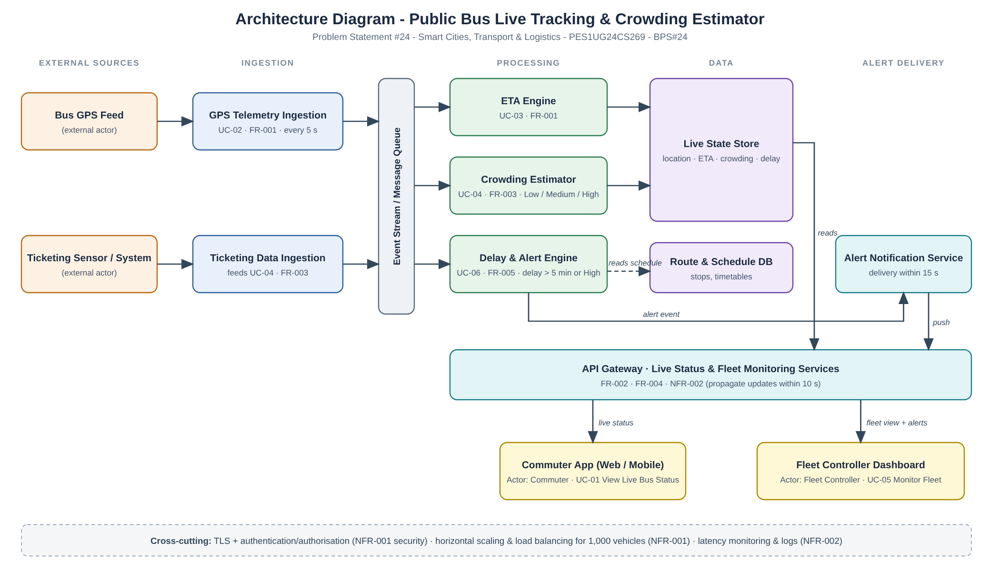

# Architecture Diagram

Files: [`architecture.png`](architecture.png) (image) · [`architecture.svg`](architecture.svg) (editable vector)

## Components

| Layer | Component | Responsibility | Traces to |
|---|---|---|---|
| External | Bus GPS Feed | Sends bus GPS coordinates | UC-02, FR-001 |
| External | Ticketing Sensor / System | Sends ticketing/occupancy data | UC-04, FR-003 |
| Ingestion | GPS Telemetry Ingestion | Receives GPS updates every 5 s | UC-02, FR-001 |
| Ingestion | Ticketing Data Ingestion | Receives ticketing sensor data | FR-003 |
| Messaging | Event Stream / Message Queue | Decouples ingestion from processing; absorbs load from up to 1,000 vehicles | NFR-001 |
| Processing | ETA Engine | Recalculates ETAs for all upcoming stops | UC-03, FR-001 |
| Processing | Crowding Estimator | Computes Low / Medium / High crowding per bus | UC-04, FR-003 |
| Processing | Delay & Alert Engine | Raises an alert when delay > 5 min or crowding is High | UC-06, FR-005 |
| Data | Live State Store | Latest location, ETA, crowding and delay per bus | FR-002, FR-004 |
| Data | Route & Schedule DB | Stops and timetables, used to measure delay | FR-004, FR-005 |
| Delivery | Alert Notification Service | Delivers alerts to the Fleet Controller within 15 s | FR-005 |
| Serving | API Gateway (Live Status & Fleet Monitoring Services) | Serves clients; keeps end-to-end propagation within 10 s | FR-002, FR-004, NFR-002 |
| Client | Commuter App (Web / Mobile) | Commuter views live bus status | UC-01, FR-002 |
| Client | Fleet Controller Dashboard | Fleet Controller monitors fleet and receives alerts | UC-05, FR-004 |

**Cross-cutting concerns:** TLS and authentication/authorisation (NFR-001 security), horizontal scaling and load balancing for 1,000 vehicles (NFR-001), latency monitoring and logging (NFR-002).

## Data flow
1. Bus GPS and ticketing sensor data enter through the ingestion services and are published to the event stream.
2. The ETA Engine, Crowding Estimator and Delay & Alert Engine consume the stream and write results to the Live State Store; the Delay & Alert Engine also reads the Route & Schedule DB.
3. The API Gateway reads the Live State Store and serves the Commuter App and the Fleet Controller Dashboard.
4. Alert events go to the Alert Notification Service, which pushes them to the Fleet Controller via the gateway.

> The technology choices (specific queue, database, etc.) are intentionally left open; this is a logical architecture derived from the requirements and use-case model.
